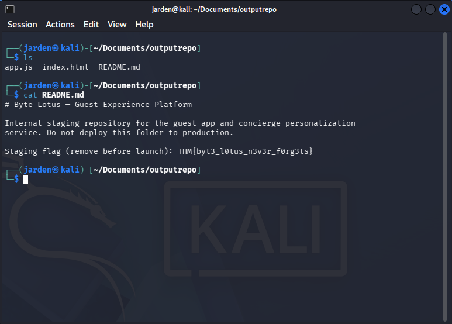

# Hacker Holidays room 2 - Room 404

**Category:** Web

**Difficulty:** Easy

**Tools used:** Browser dev tools, gobuster, git-dumper

**Skills practiced:** Directory enumeration, Git Repositories, Source Code recovery (from the exposed git repo)

## Summary

The target was a web app on port 8080 (HTTP). Directory enumeration revealed an exposed `.git` directory. I used `git-dumper` to reconstruct the repoistory's files over HTTP, and the flag was in `README.md`.

## Objective

The goal was to find the flag by dumping the exposed source code from an unsecure Git directory on the web server.

## Walkthrough

1. **Recon**

I opened `http://10.114.161.90:8080` (the web app) in a web browser and found a simple site. Viewing the page source showed nothing useful, so I moved to enumeration.

2. **Finding the Vulnerability**

I used gobuster against the web app using the `common.txt` wordlist to enumerate the available directories on the web server.

```bash
gobuster dir -u http://10.114.161.90:8080/ --wordlist /usr/share/wordlists/dirb/common.txt
```

Gobuster returned a `/.git` path. An exposed `.git` directory means that the site's version control data is publicly readable, so the source code can be recovered.

3. **Exploitation**

My first attempt was manually downloading the objects inside `.git`, they were compressed git objects so I got unreachable data. After rereading the room hints and looking online, I learned that git stores content as objects that need to be reassembled, which is what `git-dumper` does.

Then I used `git-dumper` against the web app and the exposed directory, to get the git repository onto my machine under the `outputrepo` directory. 

```bash
git-dumper http://10.114.161.90:8080/.git outputrepo
```

This gave me `app.js`, `index.html`, and `README.md`. `app.js` and `index.html` were just the site itself; `README.md` contained the flag.



**Flag:** `THM{...}` 

The flag is redacted in respect for THMs TOS (also in the screenshot).

## Root cause

The `.git` directory was deployed to the web root and served publicly, exposing the full repository.

## How to fix it

- Block access to dotfiles and directories (`.git`) in the webserver config.

- Deploy only build artifacts, no the repo itself 

- Keep secrets out of repositories, and rotate any that were exposed.

## What I struggled with and learned

### The trouble I had
- **Trouble:** I had initially trouble with the objective of the room and finding result git repository (I didn't think `gobuster` was supposed to be used). 

    **The solution:** I looked again at the room's objective, tags and instructions for what is supposed to be done, so from there I got I should enumerate the web server with `gobuster`.

- **Trouble:** I didn't know about using `git-dumper` and tried to forcefully download the `.git` content from the webserver and decrypt the SHA1 content but got junk.

  **The solution:** I looked online and read the room's instructions again. Then I found out about what is `git-dumper` and used it against the web server and the found directory with the HTTP port.

### What I learned

Git objects aren't meant to be read directly, so use a tool that reconstructs the repo (`git-dumper`). I also learned to check the room's tags and instruction closely before deciding whether a tool (like `gobuster`) is in scope.
